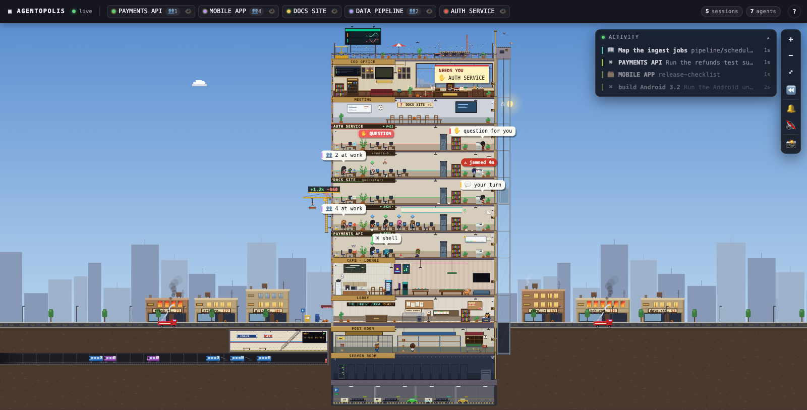
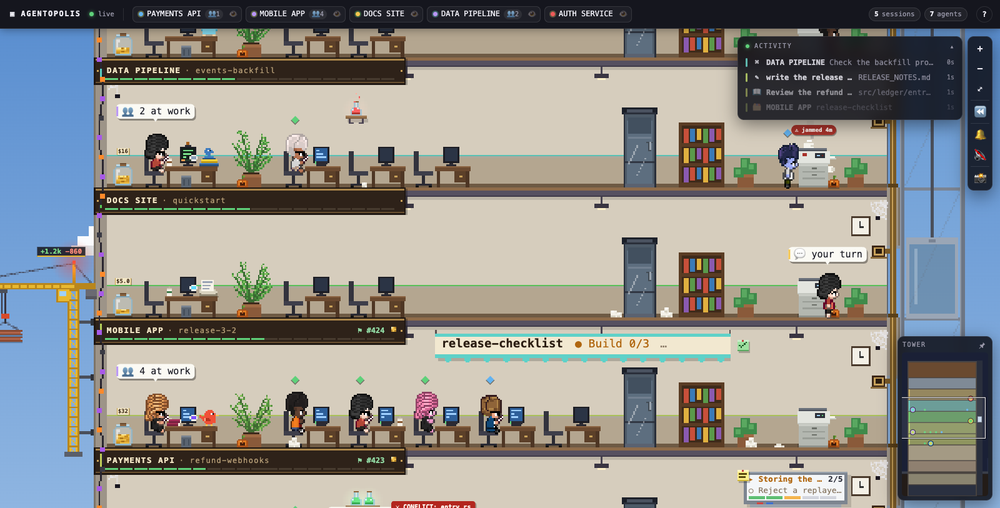
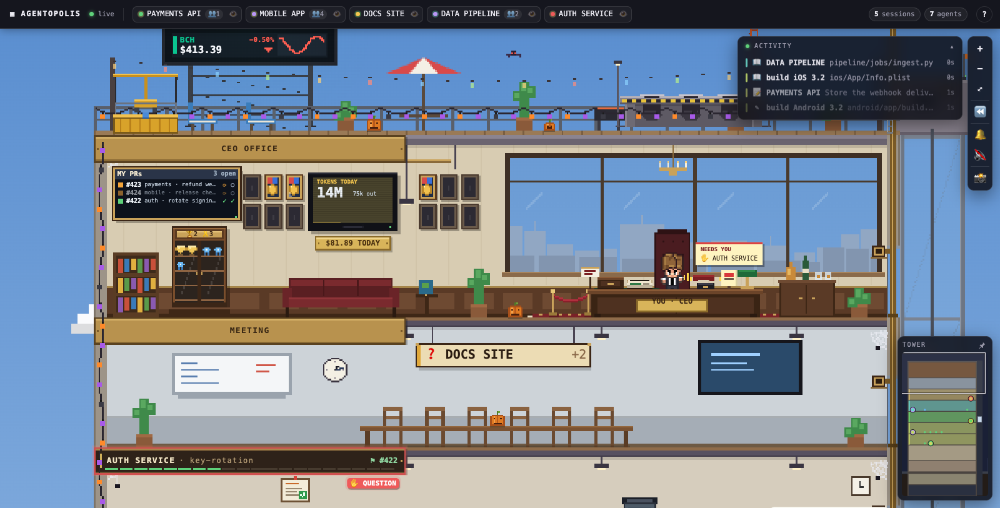
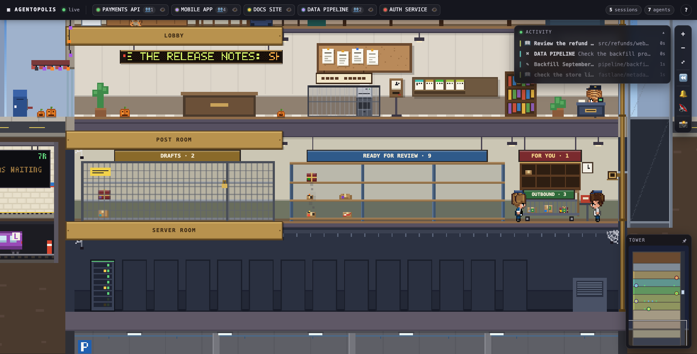
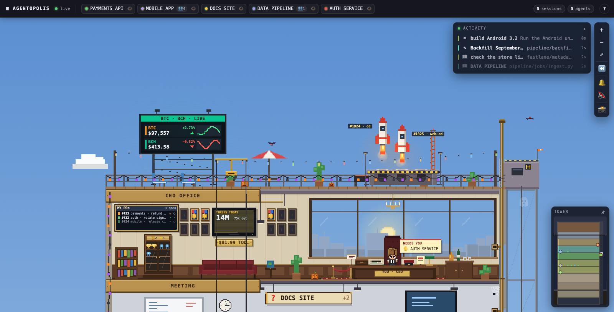
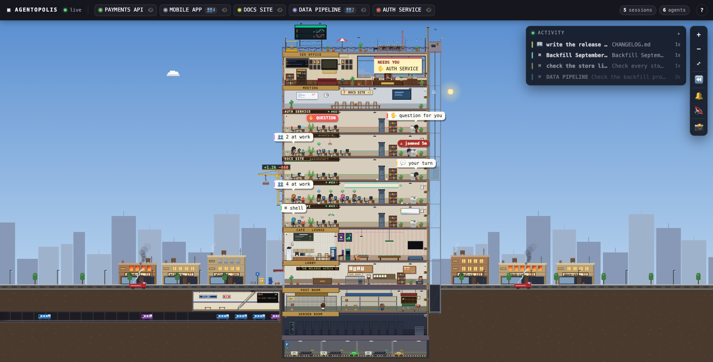
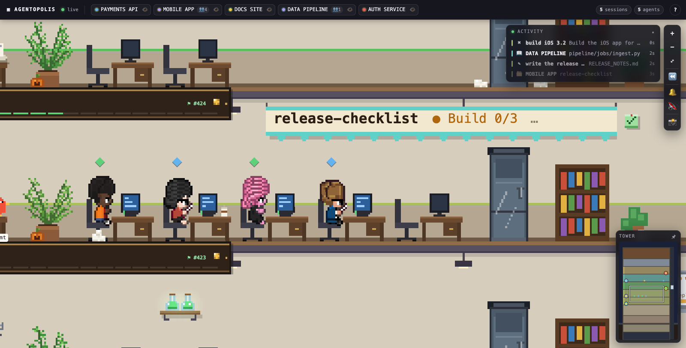

# Agentopolis

**A living pixel-art skyscraper of your Claude Code sessions.**

Every running session gets its own floor. Its subagents and workflow agents walk in through the lobby, ride the glass
elevator and sit down at the desks beside it. You watch them work, take coffee breaks, get stuck, celebrate, and queue
outside your office when they need you. Your teammates' open pull requests line the street as neighbouring buildings,
and a failing CI run sets them on fire.



It is a read-only window onto `~/.claude`. It installs no hooks, changes no settings and runs no agents. It's a plain
Node server with no dependencies and a canvas page.

## Quick start

```sh
git clone https://github.com/<you>/agentopolis && cd agentopolis
node server.mjs --name Ada # → http://127.0.0.1:4747  (your name goes on the CEO office)
node server.mjs --demo     # a made-up office, no Claude Code needed
```

You need Node 24 (the version it's tested on) and Claude Code sessions on the same machine. A few things are optional:

- **The street (needs [`gh`](https://cli.github.com))**: if you're signed in to `gh`, the street, the post room, CI and
  deploys come alive for the GitHub repo your sessions are working in. All of these calls only read.
- **Orca**: if you run your sessions in Orca, clicking a floor jumps to that
  session's terminal.
- **No data needed for the demo**: `--demo` serves an invented office (sessions, teammates, PRs, deploys). It reads
  nothing from your machine and makes no network calls, so you can try it with nothing running.

`./start.sh` starts the server in the background and opens the page.

## What's in the building

| | |
|---|---|
|  | **Session floors.** One per live session: desk, monitor, task board, plaque with context bar and cost jar. Subagents fill the spare desks; idle ones wander off to the café. |
|  | **Your office.** Sessions waiting on you queue at your desk with their last question; the phone rings for permission prompts. A board lists your open PRs and blinks red when CI fails. |
|  | **Post room.** One parcel per open PR: drafts caged, ready ones on the rack, approved ones outbound. Size by diff, cobwebs when stale, crushed on conflict. Merges leave by van. |
|  | **Roof.** Deploys launch as rockets from the pad — orbit on success, a smoking wreck on failure. Remote work leaves by helicopter. Friday drinks after 17:00. |
|  | **Street.** Teammates' buildings, one floor per open PR, on fire when CI is red. Reviewers walk over to pin notes on your floor. A red trunk triggers a fire drill. |

And a lot more, each driven by something real in your transcripts or on GitHub:

- **Work signals:** the printer jams on a tool call stuck for minutes, a character walks in circles when it retries
  the same failing call (Groundhog Day), and test-lab flasks bubble green or red per suite. Books come off the shelf
  when a skill loads, someone looks out with binoculars during web research, and a phone booth lights up while a
  browser is being driven.
- **Office life:** floors are built with scaffolding and a ribbon-cut when a session starts, and a closed one moves
  out with boxes. There's a cake at 100, 500 and 1000 tool calls, a punch clock with each session's hours, a stand-up
  at 10:00, a lunch rush at noon, a screensaver when you've been away, and holidays on the calendar.
- **Infrastructure:** a server room with a rack per background job, a parking garage with one car per session's
  model, an IT technician when a tool server drops, and a security desk that stamps DENIED on blocked actions.
- **Around the building:** weather and a day–night cycle for your time zone, the Gazette (a daily paper of the repo),
  replay of the last hours, a photo booth and an ambient soundscape.



## Demos

Add `?demo=<name>` to see any feature without waiting for it to happen. For example: `towerlife`, `moveinout`,
`waitline`, `myprs`, `postroom`, `rocket`, `helipad`, `firedrill`, `printerjam`, `groundhog`, `milestonecake`,
`walkabout`, `reviewervisits`, `fridaydrinks`, `standup`, `lunchrush`, `screensaver`, `cisubway`,
`holidays&date=2026-12-25`.

`?towerzoom=min` shows the whole street.

## Privacy

- **Local only.** The server listens on `127.0.0.1` and refuses any other `Host`.
- **Transcripts.** It only reads them (`~/.claude/projects`, `~/.claude/sessions`) and never writes under `~/.claude`.
- **GitHub.** It runs `gh` without a shell, and only read commands (`pr list`, `run list`, `api` GETs), cached and
  rate-limited. It never writes to GitHub.
- **Outbound requests.** Apart from GitHub, it makes two: [Open-Meteo](https://open-meteo.com) for the weather, for a
  coarse location taken from your system time zone (there's no IP geolocation), and a public price feed for the
  BTC/BCH billboard. Neither carries any data about you.
- **Links.** They open in your default browser via `/api/open`, which only accepts `https://github.com/` URLs from
  the page itself.

## How it works

```
~/.claude/projects/*.jsonl ─┐
~/.claude/sessions/*.json  ─┼─▶ server.mjs ──/api/state──▶ app/core.js ──▶ app/tower/ (canvas)
gh (read-only)             ─┘   server/features/*.mjs        polls 1.5 s     app/tower/features/*.js
```

- **Server.** `server.mjs` parses transcripts incrementally into a snapshot of sessions, agents and their states.
  Each file in `server/features/` can add data per session (`session(ctx)`), per agent (`agent(ctx)`) or to the
  whole snapshot (`snapshot(snap)`).
- **Tower.** `app/tower/tower.js` draws the building and owns the people, the elevator and the camera. Each file in
  `app/tower/features/` is a plugin that hooks into `sync`, `step`, `items`, `overlay`, `hover`, `click` and so on.
  The full plugin API is documented at the top of `tower.js`.
- **Page.** The DOM around the canvas (header, side panel, toasts, replay) lives in `app/features/`.

To add a feature, drop a file into `app/tower/features/`, register it in `tower.js`, and give it a `?demo=`.

Server options: `--port <n>` (default 4747), `--name <you>` (default "You"), `--demo`, `--window-min <n>` (how long an inactive but running session stays,
default 30).

## Credits

Character, furniture and pet sprites come from [Pixel Agents](https://github.com/pixel-agents-hq/pixel-agents)
(MIT, © Pablo De Lucca). The characters are based on
[JIK-A-4's Metro City](https://jik-a-4.itch.io/metrocity-free-topdown-character-pack) pack. Everything else is drawn
in code.

Not affiliated with Anthropic. "Claude" and "Claude Code" are Anthropic's trademarks.

## License

[MIT](LICENSE)
